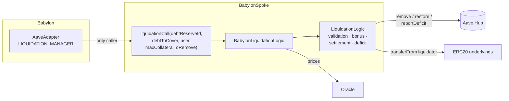
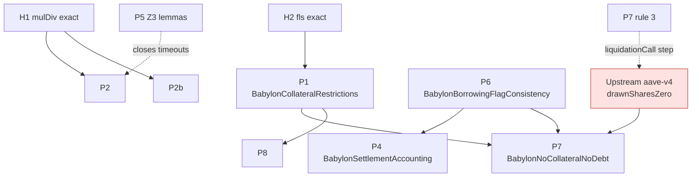

# BabylonSpoke — Formal Verification Design

This document describes what the Certora specs in this folder prove about
`BabylonSpoke`, how each property is formalized, which model it runs on, and
which assumptions it rests on. The threats these properties answer are in
[threatModel.md](threatModel.md).

> [!NOTE]
> Status values are taken from `ppties.md`, `README.md` and the Prover runs
> listed below. A local `--compilation_steps_only` pass is not a proof; only a
> cloud run with sanity checks counts.

---

## Contents

1. [System under verification](#1-system-under-verification)
2. [The liquidation pipeline](#2-the-liquidation-pipeline)
3. [Property catalogue](#3-property-catalogue)
4. [Property details](#4-property-details)
5. [Verification scenes](#5-verification-scenes)
6. [Summaries](#6-summaries)
7. [Assumption ledger](#7-assumption-ledger)
8. [Known Prover issues](#8-known-prover-issues)
9. [Open items](#9-open-items)
10. [Running the specs](#10-running-the-specs)

---

## 1. System under verification

`BabylonSpoke` is an Aave v4 Spoke specialised for Bitcoin-backed positions.
Its only collateral is vaultBTC, and its only liquidator is the Babylon
`AaveAdapter`.



### Differences from the base `Spoke`

| Area | Base `Spoke` | `BabylonSpoke` |
| --- | --- | --- |
| Reserves per user | Configurable | `USER_RESERVES_LIMIT = 1`: one collateral, one debt |
| Collateral | Any reserve with a collateral factor | Only `MANAGED_COLLATERAL_RESERVE_ID` (vaultBTC) |
| Managed reserve | Can be borrowable | `addReserve` / `updateReserveConfig` reject borrowable |
| Liquidator | Anyone | Only `LIQUIDATION_MANAGER` (immutable) |
| Liquidation sizing | Target health factor | Collateral removal cap `maxCollateralToRemove` |
| 5-argument `liquidationCall` | Live | Always reverts `UnsupportedLiquidationCall` |
| Liquidation fee | Configurable | Must be `0` (`_validateDynamicReserveConfig`) |
| Collateral payout | Assets or shares | Always underlying assets (`receiveShares = false`) |

Source: `src/spoke/BabylonSpoke.sol`,
`src/spoke/libraries/BabylonLiquidationLogic.sol`.

---

## 2. The liquidation pipeline

Every Babylon-specific property is about this one call. The numbered steps are
referenced throughout the document.

| Step | Code | What happens |
| --- | --- | --- |
| L1 | `BabylonSpoke.liquidationCall` | `msg.sender == LIQUIDATION_MANAGER`, else revert. Account data computed once. |
| L2 | `LiquidationLogic._validateLiquidationCall` | No self-liquidation, `debtToCover > 0`, reserves not paused, user has supplied shares and drawn shares, health factor `< 1`, collateral enabled with a non-zero factor. |
| L3 | `LiquidationLogic.calculateLiquidationBonus` | Bonus interpolated linearly between min and max as the health factor drops to `healthFactorForMaxBonus`. |
| L4 | `_calculateLiquidationAmounts` | Premium debt first, then drawn shares, then collateral priced with the bonus. |
| L5 | Cap resize (same function) | If priced collateral exceeds `min(previewAddByAssets(cap), suppliedShares)`, collateral is set to the cap and the repayment is recomputed from it, rounding up. |
| L6 | `LiquidationLogic._liquidateCollateral` | User's supplied shares debited; `Hub.remove` sends the assets to the liquidator. No fee. |
| L7 | `LiquidationLogic._liquidateDebt` | Liquidator's tokens pulled to the Hub; `Hub.restore`; drawn shares and premium fields updated; borrowing bit cleared at zero. |
| L8 | `_evaluateDeficit` → `notifyReportDeficit` | If the collateral is emptied while debt remains, every remaining debt position is cleared and reported to the Hub. Otherwise the risk premium is refreshed. |

### Sizing in detail (L4–L5)

```text
premiumToLiquidate = debtToCover < ceil(premiumDebt)  ?  toRay(debtToCover)  :  premiumDebt
drawnToLiquidate   = premium fully covered            ?  floor((debtToCover − ceil(premium)) · RAY / drawnIndex) ∧ drawnShares
                                                       :  0
collateralShares   = canonical bonus pricing of (premiumToLiquidate, drawnToLiquidate)

if collateralShares > maxRemovableShares:                       # cap resize
    collateralShares = maxRemovableShares
    debtRay          = ceil( value(collateralShares) · 10000 / bonus )   # in debt units
    split debtRay into premium first, then drawn shares (rounded up)
```

The resize branch is where most of the arithmetic risk sits: it inverts the
pricing and rounds up, so the specs and the offline Z3 proofs check that it
never overshoots the first sizing.

---

## 3. Property catalogue

| ID | Property | Kind | Spec | Status |
| --- | --- | --- | --- | --- |
| **P1** | Collateral restrictions | Invariants | [BabylonCollateralRestrictions.spec](specs/BabylonCollateralRestrictions.spec) | ✅ Verified on an earlier snapshot · current target needs a fresh run |
| **P2** | Liquidator payment bounds | Rules | [BabylonLiquidationPaymentBounds.spec](specs/BabylonLiquidationPaymentBounds.spec) | ⏳ No counterexample · times out (76% / 90% proved) · backed by Z3 |
| **P2b** | Collateral within bonus-priced repayment | Rule | [BabylonLiquidationCollateralBound.spec](specs/BabylonLiquidationCollateralBound.spec) | ⚪ Status not recorded |
| **P3** | Collateral removal bounds | Rules | [BabylonCollateralRemovalBounds.spec](specs/BabylonCollateralRemovalBounds.spec) | ✅ Reported OK |
| **P4** | Settlement accounting | Rules | [BabylonSettlementAccounting.spec](specs/BabylonSettlementAccounting.spec) | ✅ Reported OK |
| **P5** | Sizing arithmetic lemmas | Offline Z3 | (not in this folder) | ✅ Proved |
| **P6** | Borrowing flag ⇔ drawn shares | Invariant | [BabylonBorrowingFlagConsistency.spec](specs/BabylonBorrowingFlagConsistency.spec) | 🔲 Written · not run |
| **P7** | No debt without collateral | Rules | [BabylonNoCollateralNoDebt.spec](specs/BabylonNoCollateralNoDebt.spec) | 🔧 Two tool errors fixed · awaiting run |
| **P8** | Liquidation splitting gives no advantage | Relational rules | [BabylonLiquidationSplitting.spec](specs/BabylonLiquidationSplitting.spec) | 🔧 Tool error fixed · awaiting run · **violation expected** |
| H1 | `Math.mulDiv` model is exact | Rule | [BabylonPaymentMath.spec](specs/BabylonPaymentMath.spec) | ✅ Verified |
| H2 | `LibBit.fls` model is exact | Rule | [BabylonBitMathEquivalence.spec](specs/BabylonBitMathEquivalence.spec) | ✅ Verified |

**Legend.** ✅ verified · ⏳ partial (timeout, no counterexample) ·
🔧 tool error fixed, rerun pending · 🔲 not run · ⚪ unknown.
H-rows are helper proofs that justify summaries used by the P-rows.

---

## 4. Property details

Each section gives the plain-English property, the exact CVL statement, the
model it runs on, and what it does **not** cover.

### P1 · Collateral restrictions

> Only vaultBTC can ever be collateral, vaultBTC can never be borrowed, and a
> user holds at most one collateral reserve and one debt reserve.

| Invariant | Statement |
| --- | --- |
| `unlistedReserveIsEmpty` | `reserveId ≥ reserveCount ⇒ hub == 0 ∧ ¬collateralBit ∧ ¬borrowingBit` |
| `onlyManagedCollateral` | listed `reserveId` with a collateral bit ⇒ `reserveId == MANAGED` |
| `collateralCountAtMostOne` | `reserveCount ≤ 4 ⇒ collateralCount(user) ≤ 1` |
| `borrowCountAtMostOne` | `reserveCount ≤ 4 ⇒ borrowCount(user) ≤ 1` |
| `managedReserveNeverBorrowable` | `¬borrowable(MANAGED)` |
| `managedReserveNeverBorrowed` | `MANAGED` listed ⇒ no user has its borrowing bit |

- **Checked against:** every Spoke function, governance functions included,
  except `multicall`.
- **Model:** real bitmap code with `precise_bitwise_ops`; `LibBit.fls`
  replaced by `exactFls`, proved equal by H2. Account data, sizing, bonus and
  premium deltas are arbitrary (they do not write the bitmap). Signed premium
  delta fields are fixed to zero; README explains why this is a projection.
- **Scope:** at most four listed reserves; `loop_iter 5`, pessimistic loops.
- **Not covered:** proxy upgrades onto existing state; `multicall` wrapper.

### P2 · Liquidator payment bounds

> In a successful liquidation the liquidator pays at most `debtToCover`, and at
> most the user's debt in `debtReserveId`, premium included.

| Rule | Assertion |
| --- | --- |
| `liquidationPaymentWithinDebtToCover` | Σ tokens requested from the liquidator ≤ `debtToCover` |
| `liquidationPaymentWithinUserDebt` | Σ tokens requested ≤ user's pre-call drawn + premium debt in the reserve |
| `galoisLemma` | `floor(x·k/q) ≥ n ⇒ ceil(n·q/k) ≤ x`, used by both rules |

- **Model:** `mulDiv` is `exactMulDiv` (H1). Hub views follow `Hub.sol` with
  `SharesMath` rounding; this is a trust assumption on the Hub (README).
  Prices, bonus and account data are arbitrary. Hub writes and deficit
  reporting are `HAVOC_ALL` after the pull.
- **Status:** no counterexample; both assertions time out with 76% and 90% of
  the split tree proved. Z3 proofs 3 and 4 (P5) cover the resize branch.

### P2b · Collateral within bonus-priced repayment

> The collateral removed is worth at most the debt actually paid times
> `liquidationBonus / 10000`.

- **Rule:** `collateralWithinBonusPricedRepayment`, with intermediate
  assertions on share conversion, pricing and payment bounds.
- **Model:** same as P2, without the Galois facts; every rounded pricing call is
  recorded and its floor/ceil inequality asserted.

### P3 · Collateral removal bounds

> The liquidator never receives more than `maxCollateralToRemove`, nor more
> than the user supplied, and the user's shares drop by exactly what was
> removed.

| Rule | Assertion |
| --- | --- |
| `collateralRemovalBounds` | share debit ≤ supplied shares; ≤ cap in shares (round down); returned assets = debit in assets (round down); returned assets ≤ cap and ≤ pre-call value of the supply |
| `collateralValueDrop` | value(before) − value(after) ≤ cap, both at the pre-call rate |

`collateralValueDrop` exists because "rounded before − rounded after" can
differ by one from "rounded difference".

### P4 · Settlement accounting

> Repayment settles only the named debt reserve, the collateral debit is sent
> to the liquidator in full with no fee, and a deficit is reported exactly when
> the collateral is emptied while debt remains.

| Rule | Assertion |
| --- | --- |
| `repaymentSettlesOnlyDebtReserve` | one `transferFrom` liquidator → debt Hub in the debt token; one `restore` on the debt Hub and asset; drawn and premium fields written only in the user's debt position |
| `collateralDebitSentToLiquidator` | no `payFeeShares`; supply written only in the user's collateral position; a positive debit triggers exactly one `remove` of its full value to `msg.sender`; returned amount = debit value |
| `deficitIffCollateralEmptiedWithDebt` | `notifyReportDeficit` called once iff collateral is empty ∧ (drawn shares remain ∨ another borrowing bit is set), for the liquidated user |

- **Model:** sizing results arbitrary; Hub and token effects recorded, not
  executed; `notifyReportDeficit` recorded with its debt clearing omitted.
- **Assumes:** positive drawn shares imply the borrowing bit. P6 discharges this.

### P5 · Sizing arithmetic lemmas (offline Z3)

| # | Lemma |
| --- | --- |
| Z1 | Payout ≤ cap: the cap is converted to shares rounding down and back to assets rounding down (`LiquidationLogic.sol:459`). |
| Z2 | The user's collateral value drops by at most the cap. |
| Z3 | Premium-only resize: the resized premium ≤ the original premium, despite `roundRayUp`. When the original was limited by `debtToCover` it was already a whole unit. |
| Z4 | Drawn-debt resize: resized drawn shares ≤ original drawn shares. Since resized ≥ 1, the original sizing had already repaid the full premium. |

These close the branches where the Prover times out in P2.

### P6 · Borrowing flag matches drawn shares

> A user's borrowing bit for a reserve is set exactly when they have drawn
> shares there.

```cvl
invariant borrowingFlagIffDrawnShares(address user, uint256 reserveId)
    harnessIsBorrowing(user, reserveId) <=> _userPositions[user][reserveId].drawnShares > 0
```

- **Checked against:** every Spoke function, including the 4-argument
  `liquidationCall`, except `multicall`.
- **Model:** no requires, no preserved blocks. The real `HubInstance` is linked
  so `Hub.draw` returns at least one share; prices and other externals are
  arbitrary.
- **Scope:** `optimistic_loop`, `loop_iter 3` (bounded proof).
- **Why it matters:** the health-factor loop and the deficit loop only see
  reserves whose bit is set. It also discharges P4's and P7's assumption.

### P7 · No debt without collateral

> After a Babylon liquidation, a user with no collateral has no debt in any
> reserve, deficit clearing included.

| Rule | Assertion |
| --- | --- |
| `noCollateralNoDebtAfterLiquidation` | for the liquidated user and any reserve `r`: `¬hasCollateral ⇒ noDebt(r)` |
| `liquidationKeepsNoCollateralNoDebtForOthers` | same implication preserved for any other user |
| `liquidationKeepsPremiumBackedByDrawnShares` | `drawnShares == 0 ⇒ premium fields == 0` preserved for any user and reserve |

- `hasCollateral` = supplied shares > 0 ∧ collateral bit ∧ collateral factor > 0
  (exactly what `_processUserAccountData` counts).
- `noDebt` = drawn shares, premium shares and premium offset all zero.
- Stated on storage, not on account data, because account data cannot see
  debt in a reserve whose bit is not set.
- **Model:** real Hub, oracle, token, deficit loop and `Hub.reportDeficit`.
- **Scope:** `loop_iter 3`, pessimistic loops; requires ≤ 4 reserves and
  `borrowCount ≤ 1` as a loop bound (see §7).

### P8 · Liquidation splitting gives no advantage

> From the same state, two back-to-back liquidations never give the liquidator
> more collateral for the same debt repaid than one combined liquidation.

```text
Split:     liquidationCall(d1, m1); liquidationCall(d2, m2)
Combined:  liquidationCall(d1 + d2, m1 + m2)   at the same initial storage
Paid:      drop in the liquidator's debt-token balance
```

| Rule | Assertion |
| --- | --- |
| `splitGivesNoMoreCollateralForSameDebt` | `paidSplit == paidCombined ⇒ collateralSplit ≤ collateralCombined` |
| `splitGivesNoBetterRate` | `collateralSplit · paidCombined ≤ collateralCombined · paidSplit` |

- **Model:** real Spoke, Hub, interest-rate strategy and two OpenZeppelin
  ERC20s; a one-price-per-reserve oracle. Nothing in the math is summarized.
- **Expected result: violation.** The bonus grows as the health factor drops
  (L3), and a liquidation lowers the health factor when
  `healthFactor < bonus × collateralFactor`. The second call of a split then
  gets a higher bonus than the combined call.

  | Scenario (CF 80%, bonus 105–110%, HF 0.8) | Bonus | Collateral removed |
  |---|---|---|
  | Split: repay 10, then 10 | 107.00% → 107.06% | 21.406 |
  | Combined: repay 20 | 107.00% | 21.400 |

  The rate rule should also fail on rounding dust alone.

---

## 5. Verification scenes

| Conf | Verified contract | Hub | Oracle | Tokens | Bitwise | Loops |
| --- | --- | --- | --- | --- | --- | --- |
| BabylonCollateralRestrictions | `BabylonSpokeHarness` | arbitrary returns | `NONDET` | arbitrary | precise | 5, pessimistic |
| BabylonLiquidationPaymentBounds | `BabylonSpokeInstance` | CVL model of `Hub.sol` views | ghost per reserve | recorded | integer | 2, pessimistic |
| BabylonLiquidationCollateralBound | `BabylonSpokeInstance` | CVL model of `Hub.sol` views | ghost per reserve | recorded | integer | 2, pessimistic |
| BabylonCollateralRemovalBounds | `BabylonSpokeInstance` | CVL model of added-asset conversions; writes `HAVOC_ALL` | `NONDET` | `safeTransferFrom` omitted | integer | 5, pessimistic |
| BabylonSettlementAccounting | `BabylonSpokeInstance` | recorded calls, arbitrary conversion | `NONDET` | recorded | integer | 5, pessimistic |
| BabylonBorrowingFlagConsistency | `BabylonSpokeHarness` | **real** `HubInstance` | arbitrary | arbitrary | precise | 3, optimistic |
| BabylonNoCollateralNoDebt | `BabylonSpokeAccountDataHarness` | **real** `HubInstance` + rate strategy | storage price, non-zero | **real** OZ ERC20 | precise | 3, pessimistic |
| BabylonLiquidationSplitting | `BabylonSpokeAccountDataHarness` | **real** `HubInstance` + rate strategy | storage price, non-zero | **real** OZ ERC20 ×2 | precise | 3, optimistic |

The older specs (P1–P4) model the Hub and summarize heavily to stay tractable.
The newer specs (P6–P8) put real contracts in the scene and keep only the
summaries the Prover cannot do without.

### Harnesses

| File | Adds |
| --- | --- |
| [BabylonSpokeHarness.sol](harness/BabylonSpokeHarness.sol) | Read-only bitmap and flag readers: `harnessIsCollateral`, `harnessIsBorrowing`, `harnessCollateralCount`, `harnessBorrowCount`, `harnessIsBorrowable` |
| [BabylonSpokeAccountDataHarness.sol](harness/BabylonSpokeAccountDataHarness.sol) | `harnessAccountData(user)` = `_processUserAccountData(user, false)`, used by the pointer-analysis summary |
| [NoCollateralNoDebtMocks.sol](harness/NoCollateralNoDebtMocks.sol) | OZ ERC20 with empty constructor; oracle with one stored price per reserve |
| [LiquidationSplittingOracle.sol](harness/LiquidationSplittingOracle.sol) · [LiquidationSplittingTokens.sol](harness/LiquidationSplittingTokens.sol) | Same oracle; two OZ ERC20 instances |
| `PaymentMathHarness.sol` · `BitMathHarness.sol` | Expose `Math.mulDiv` and `LibBit.fls` for H1 and H2 |

---

## 6. Summaries

Every summary falls into one of four classes. A spec is only as sound as its
weakest summary class.

| Class | Meaning | Effect on a proof |
| --- | --- | --- |
| **Exact** | Same input/output behaviour as the code, proved or argued | None |
| **Over-approximation** | Returns any value the code could, and more | Sound; may add spurious counterexamples |
| **Projection** | Drops data the property never reads | Sound only if the "never reads" argument holds |
| **Omitted effect** | Skips a write or call | Sound only for properties that do not depend on it |

| Summary | Used in | Class | Justification |
| --- | --- | --- | --- |
| `extSload` / `extSloads` → `NONDET DELETE` | all Spoke specs | Exact for the properties | Views; never called internally; removing them lets storage analysis succeed |
| `LibBit.fls` → `exactFls` | P1 | Exact | Proved by H2 for every `uint256` |
| `Math.mulDiv` → `exactMulDiv` | P2, P2b | Exact | Proved by H1 when `x·y` fits 256 bits; larger products rely on OpenZeppelin |
| `Math.mulDiv`, `divUp`, `rayMulUp` → `NONDET` | P3 | Over-approximation | Debt-side arithmetic does not feed the collateral bound |
| `KeyValueList.sortByKey` → no-op | P7, P8 | Exact under a precondition | One-entry list; P7 asserts the length, P8 requires it (P1 count invariant) |
| `KeyValueList.uncheckedAt` → CVL read | P7, P8 | Exact | Same element and unpacking; asserts index in bounds |
| `SafeERC20.safeTransfer(From)` → token call | P7, P8 | Exact for bool-returning tokens | Same callee, `msg.sender` = calling contract |
| `_calculateUserAccountData` → `harnessAccountData` | P7, P8 | Exact | Defined as `_processUserAccountData(user, false)` |
| Oracle price → ghost / `NONDET` | P1–P4 | Over-approximation | Properties hold for any price |
| `calculateLiquidationBonus` → `NONDET` | P1, P2, P4 | Over-approximation | Pure; any bonus |
| `_calculateLiquidationAmounts` → arbitrary | P1, P4 | Over-approximation | Read-only; sizing correctness is P2/P3's job |
| `_calculateUserAccountData` → arbitrary | P1, P2, P4 | Over-approximation + omitted `dynamicConfigKey` write | Frame argument in README |
| `calculatePremiumDelta` signed fields → 0 | P1 | Projection | Only consumed by summarized Hub calls and events |
| `_notifyRiskPremiumUpdate` → `NONDET` | P1–P4 | Omitted effect | Runs after the pull; does not touch bitmap or settlement fields |
| `notifyReportDeficit` → `HAVOC_ALL` / recorded | P2, P2b / P4 | Over-approximation / omitted effect | P4 checks the call; **P7 runs it for real** |
| `unresolved external in _._` → `ASSERT_FALSE` | all | Fail-closed | An unresolved call fails the rule instead of being havoced |

---

## 7. Assumption ledger

Every `require` that is not a pure case split must point to where it is
proved. Arrows read "relies on".



| Assumption | Used by | Discharged by | Status |
| --- | --- | --- | --- |
| `reserveCount ≤ 4` | P1, P7 | — | **Scope limit**; larger spokes not covered |
| `collateralCount(user) ≤ 1` | P7, P8 | P1 `collateralCountAtMostOne` | Proved within scope |
| `borrowCount(user) ≤ 1` | P7 (loop bound) | P1 `borrowCountAtMostOne` | Proved within scope |
| borrowing bit ⇒ `reserveId < reserveCount` | P7 | P1 `unlistedReserveIsEmpty` | Proved |
| drawn shares > 0 ⇒ borrowing bit | P4, P7 | P6 | Pending P6 run |
| drawn shares = 0 ⇒ premium fields = 0 | P7 | Upstream `drawnSharesZero` + P7 rule 3 | **Open** for inherited functions on `BabylonSpoke` |
| debt token ≠ collateral token | P8 | P1 never-borrowed + `addReserve` / `Hub.addAsset` checks | Partly code-review |
| No re-entrancy from externals | P6, P7, P8 | `nonReentrant` guards | Argued, not proved |
| Hub views follow `Hub.sol` | P2, P2b, P3 | Real Hub in P6–P8 | Trust assumption for P2–P3 |
| Loops bounded | all | `loop_iter` 2–5 | Bounded proof |

---

## 8. Known Prover issues

| Symptom | Cause | Resolution |
| --- | --- | --- |
| "Could not compile access to contract storage … missing context" | `extSload` reads caller-chosen slots, so storage analysis of the Spoke fails | `extSload` / `extSloads` → `NONDET DELETE` |
| "A havoc result that should be unreachable" on every call in `liquidationCall` | Pointer analysis fails on `liquidationCall` (struct literal around `_calculateUserAccountData`) and on `SafeERC20` / `unsafeMemoryAccess` assembly; no call is then resolved | [helpers/PointerAnalysisSummaries.spec](specs/helpers/PointerAnalysisSummaries.spec) |
| Repayment unreachable under `precise_bitwise_ops` | Signed `int256` fields in the `PremiumDelta` summary | Signed fields projected to zero (P1); minimal repro in README |
| Spurious bitmap counterexamples | Integer bitwise mode over-approximates masks | Keep `precise_bitwise_ops` for bitmap properties |
| Timeouts in P2 | Non-linear pricing through two `mulDiv`s | Offline Z3 lemmas (P5) |

---

## 9. Open items

1. **Run P6, P7, P8** on the cloud. P6 does not yet import the pointer-analysis
   summaries and will likely need them.
2. **Prove `drawnSharesZero` on `BabylonSpoke`** for every inherited function,
   not just `liquidationCall`.
3. **Confirm or refute the P8 bonus drift** with a concrete counterexample, then
   add a fixed-bonus variant to separate it from rounding dust.
4. **`multicall`** is filtered in every parametric check.
5. **Fresh run of P1** on the simplified target (README).
6. **Raise the reserve-count scope** beyond four if the deployment needs it.

---

## 10. Running the specs

From the repository root, with Solidity 0.8.28 and `CERTORAKEY` set:

```sh
# Helper proofs
certoraRun certora/confs/BabylonPaymentMath.conf
certoraRun certora/confs/BabylonBitMathEquivalence.conf

# Original Babylon properties
certoraRun certora/confs/BabylonCollateralRestrictions.conf
certoraRun certora/confs/BabylonLiquidationPaymentBounds.conf
certoraRun certora/confs/BabylonLiquidationCollateralBound.conf
certoraRun certora/confs/BabylonCollateralRemovalBounds.conf
certoraRun certora/confs/BabylonSettlementAccounting.conf

# Relational and cross-cutting properties
certoraRun certora/confs/BabylonBorrowingFlagConsistency.conf
certoraRun certora/confs/BabylonNoCollateralNoDebt.conf
certoraRun certora/confs/BabylonLiquidationSplitting.conf
```

Add `--compilation_steps_only` to type-check without submitting. Review every
generated sanity verdict before treating a run as verified.
