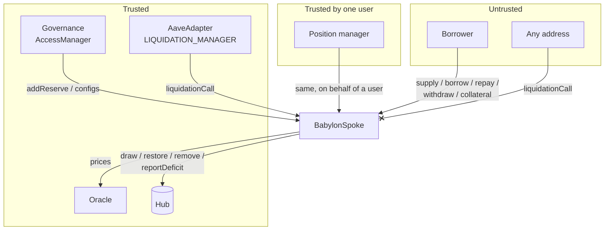

# BabylonSpoke — Threat Model

This document states what can go wrong with `BabylonSpoke`, who could cause it,
and which formal property answers each threat. It is the yardstick the specs in
this folder are measured against: a spec is useful only if it rules out a
threat listed here. How each property is formalized is in
[design.md](design.md).

---

## Contents

1. [Scope](#1-scope)
2. [System context and trust boundaries](#2-system-context-and-trust-boundaries)
3. [Assets](#3-assets)
4. [Actors](#4-actors)
5. [Security goals](#5-security-goals)
6. [Threat catalogue](#6-threat-catalogue)
7. [How properties are inferred](#7-how-properties-are-inferred)
8. [How a spec is measured](#8-how-a-spec-is-measured)
9. [Residual risks](#9-residual-risks)

---

## 1. Scope

| In scope | Out of scope |
| --- | --- |
| `BabylonSpoke` and its overrides of `Spoke` | `AaveAdapter`, `BTCVaultSwap`, vault registry (covered by the adapter's `SECURITY_MODEL.md`) |
| `BabylonLiquidationLogic` | Bitcoin-side vault scripts and peg-in / peg-out |
| The parts of `LiquidationLogic` it calls | Oracle correctness and price manipulation |
| Interaction with the Hub through the Spoke | Hub internals beyond what the Spoke relies on |
| Governance configuration of the Spoke | Upgrading a proxy onto existing state |

The base `Spoke` is verified upstream (Certora `aave-v4-pub`). This model
focuses on what Babylon changes and on upstream checks that do not reach the
Babylon code paths, notably the 4-argument `liquidationCall`, which upstream
excludes from every parametric rule.

---

## 2. System context and trust boundaries

| Boundary | What crosses it | Guard |
| --- | --- | --- |
| User → Spoke | Position changes | `onlyPositionManager(onBehalfOf)`, health-factor checks |
| Liquidator → Spoke | `liquidationCall` | `msg.sender == LIQUIDATION_MANAGER` |
| Governance → Spoke | Reserve and liquidation config | `restricted` (AccessManager), Babylon overrides |
| Spoke → Hub | Liquidity and debt accounting | Hub's own Spoke registration |
| Spoke → Oracle | Prices | Trusted; non-zero enforced by the oracle |

---

## 3. Assets

| Asset | Owner | Loss looks like |
| --- | --- | --- |
| **A1** vaultBTC collateral | Borrower | Seized beyond what the debt repaid justifies |
| **A2** Hub liquidity | Lenders | Debt erased without repayment, or bad debt not reported |
| **A3** Liquidator funds | `AaveAdapter` / keepers | Charged more than requested or more than the debt |
| **A4** Accounting integrity | Protocol | Debt invisible to health-factor and deficit logic |
| **A5** Configuration invariants | Protocol | vaultBTC borrowable, other collateral accepted, fees enabled |

---

## 4. Actors

| Actor | Trust | Can do | Assumed not to |
| --- | --- | --- | --- |
| Borrower | Untrusted | Any user function on own position | — |
| Position manager | Trusted by the user who approved it | User functions on behalf of that user | Act against other users |
| `LIQUIDATION_MANAGER` | Trusted for liveness, **not** for bounds | Liquidate with any `debtToCover` and cap | — Spoke-level bounds must hold for any inputs it sends |
| Governance | Trusted for intent | List reserves, change configs | — Babylon config rules must hold for any governance call |
| Oracle | Trusted | Return prices | Return stale or manipulated prices |
| Hub | Trusted | Convert shares, move liquidity | Call back into the Spoke |
| Underlying tokens | Trusted | Transfer | Charge fees, rebase, re-enter |

> [!IMPORTANT]
> The liquidation manager and governance are trusted **parties** but not
> trusted **inputs**. Every liquidation property is checked for arbitrary
> `debtToCover`, `maxCollateralToRemove` and `debtReserveId`, and every
> configuration invariant is checked across all governance functions.

---

## 5. Security goals

Grouped by the party each goal protects.

| Goal | Protects | Statement |
| --- | --- | --- |
| **G1** | Protocol | The Spoke only ever holds vaultBTC as collateral, and vaultBTC is never debt. |
| **G2** | Protocol | Each user has at most one collateral and one debt position. |
| **G3** | Liquidator | A liquidation never charges more than requested, nor more than the user owes. |
| **G4** | Borrower | A liquidation never removes more collateral than the cap, the supply, or the bonus-priced repayment justifies. |
| **G5** | Borrower | Repeated or split liquidations extract no more than one equivalent liquidation. |
| **G6** | Lenders | Debt is only reduced by repayment in the named reserve or by deficit reporting. |
| **G7** | Lenders | A user left with no collateral is left with no debt; the remainder is reported as deficit. |
| **G8** | Protocol | Position flags and stored shares never disagree. |
| **G9** | Borrower | No hidden fee: the liquidator receives exactly what is debited. |

---

## 6. Threat catalogue

**Status legend.** ✅ property proved · ⏳ no counterexample, timeout ·
🔧 spec ready, awaiting run · ❗ violation expected · ➖ not formally verified.

### Configuration and position shape

| ID | Threat | Attacker | Goal | Property | Status |
| --- | --- | --- | --- | --- | --- |
| T1 | A reserve other than vaultBTC is enabled as collateral | Borrower, governance mistake | G1 | P1 `onlyManagedCollateral` | ✅ |
| T2 | vaultBTC is listed or reconfigured as borrowable | Governance mistake | G1 | P1 `managedReserveNeverBorrowable` | ✅ |
| T3 | A user borrows vaultBTC | Borrower | G1 | P1 `managedReserveNeverBorrowed` | ✅ |
| T4 | A user opens a second collateral or debt, breaking the adapter's single-reserve assumption and the deficit check | Borrower | G2 | P1 count invariants | ✅ |
| T5 | A non-zero liquidation fee is configured | Governance mistake | G9 | `_validateDynamicReserveConfig` | ➖ code check |

### Liquidation amounts

| ID | Threat | Attacker | Goal | Property | Status |
| --- | --- | --- | --- | --- | --- |
| T6 | Liquidator pays more than `debtToCover` | Sizing bug | G3 | P2 `liquidationPaymentWithinDebtToCover` | ⏳ + Z3 |
| T7 | Liquidator pays more than the user's debt | Sizing bug | G3 | P2 `liquidationPaymentWithinUserDebt` | ⏳ + Z3 |
| T8 | Cap-resize rounding overshoots the first sizing | Rounding | G3 | P5 Z3 lemmas 3 and 4 | ✅ offline |
| T9 | Collateral removed exceeds the cap or the supply | Sizing bug | G4 | P3 `collateralRemovalBounds` | ✅ |
| T10 | Rounding lets the user's collateral value drop by more than the cap | Rounding | G4 | P3 `collateralValueDrop`, Z3 lemma 2 | ✅ |
| T11 | Collateral removed is worth more than repayment × bonus | Pricing bug | G4 | P2b `collateralWithinBonusPricedRepayment` | ⚪ not recorded |
| T12 | Splitting one liquidation into several gives a higher bonus or better rounding | Liquidation manager | G5 | P8 splitting rules | ❗ 🔧 |

### Settlement and accounting

| ID | Threat | Attacker | Goal | Property | Status |
| --- | --- | --- | --- | --- | --- |
| T13 | Repayment credited to the wrong reserve, or another user's position written | Logic bug | G6 | P4 `repaymentSettlesOnlyDebtReserve` | ✅ |
| T14 | Collateral debited but not all sent to the liquidator; fee charged | Logic bug | G9 | P4 `collateralDebitSentToLiquidator` | ✅ |
| T15 | Collateral emptied, debt remains, no deficit reported | Logic bug | G7 | P4 `deficitIffCollateralEmptiedWithDebt` | ✅ |
| T16 | Deficit reported but some debt (e.g. premium) survives the clearing | Logic bug | G7 | P7 `noCollateralNoDebtAfterLiquidation` | 🔧 |
| T17 | A liquidation breaks "no collateral ⇒ no debt" for another user | Logic bug | G7 | P7 `liquidationKeepsNoCollateralNoDebtForOthers` | 🔧 |
| T18 | Premium left in a position with zero drawn shares | Logic bug | G7, G8 | P7 `liquidationKeepsPremiumBackedByDrawnShares` | 🔧 |
| T19 | Borrowing bit and drawn shares disagree, so debt is invisible to the health factor and deficit loops | Logic bug | G8 | P6 `borrowingFlagIffDrawnShares` | 🔧 |

### Access and environment

| ID | Threat | Attacker | Goal | Property | Status |
| --- | --- | --- | --- | --- | --- |
| T20 | Someone other than the manager liquidates | Any address | — | `require(msg.sender == LIQUIDATION_MANAGER)` | ➖ code check |
| T21 | The inherited 5-argument liquidation bypasses the cap and the manager | Any address | — | Override always reverts | ➖ code check |
| T22 | A healthy user is liquidated | Liquidation manager | G4 | Upstream `healthyAccountCannotBeLiquidated` on the shared validator | ➖ upstream |
| T23 | A token or Hub call re-enters the Spoke mid-liquidation | Malicious token | all | `nonReentrant`; no callbacks in the scenes | ➖ assumed |
| T24 | A batch through `multicall` reaches a state no single call can | Borrower | all | Filtered from every parametric check | ➖ open |
| T25 | Manipulated price triggers an unfair liquidation | Oracle attacker | G4 | Properties hold for any price; oracle itself out of scope | ➖ out of scope |

> [!NOTE]
> T20 and T21 are single `require` checks. They are better served by unit
> tests than by the Prover, and were deliberately not formalized.

---

## 7. How properties are inferred

The properties were derived from the threats, not from the code. Four lenses
were applied in order; each produces a different kind of property.

| Lens | Question | Kind of property | Examples |
| --- | --- | --- | --- |
| **Design invariants** | What does the Babylon design promise about every reachable state? | Invariant, all functions | P1, P6 |
| **Per-party guarantees** | For each party in a liquidation, what is the worst outcome the code must prevent? | Pre/post rule on one call | P2, P2b, P3, P4 |
| **Cross-state consistency** | Which facts must stay true across all positions, not just the touched one? | Rule over an arbitrary other user or reserve | P4 frame checks, P7 rules 2–3 |
| **Relational behaviour** | Do two executions from the same state compare the way the economics say they should? | Two-run rule with `at init` | P8 |

### Guidance for new properties

1. **Start from a threat in §6** and name the party that loses.
2. **State it in one sentence** a non-specialist can check against the code.
3. **Pick the strongest form that is still true.** An invariant beats a rule;
   a rule over any user beats one over the liquidated user.
4. **Prefer properties the Prover is uniquely good at.** Universally
   quantified invariants and two-run comparisons find what fuzzing misses.
   Single `require` checks belong in unit tests.
5. **Write down every assumption** before the first run, with where it is
   proved (see design.md §7).
6. **Expect some properties to fail.** A counterexample to a well-stated
   economic property (P8) is a finding, not a broken spec.

---

## 8. How a spec is measured

A property counts as covered only when its spec meets every row of this
checklist.

| # | Criterion | Why |
| --- | --- | --- |
| M1 | Every summary is exact, an over-approximation, or a projection with a written argument | An under-approximating summary can hide a bug |
| M2 | Every `require` is a case split, restates a proved invariant, or is listed as a scope limit | An unjustified `require` can make the rule vacuous |
| M3 | `rule_sanity` passes and no rule is vacuous | A vacuous rule proves nothing |
| M4 | No unresolved external call is silently havoced (`ASSERT_FALSE` default) | A havoc can make the code under test disappear |
| M5 | Loop bounds and reserve-count scope are stated next to the result | A bounded proof must say its bound |
| M6 | The Global Problems view is free of storage and pointer-analysis failures on the function under test | Those failures turn real calls into havocs |
| M7 | Helper models (mulDiv, fls) are proved separately | The main proof inherits their correctness |

| Spec | M1 | M2 | M3 | M4 | M5 | M6 | M7 |
| --- | --- | --- | --- | --- | --- | --- | --- |
| BabylonCollateralRestrictions | ✅ projection argued | ✅ | ✅ earlier run | ✅ | ✅ ≤ 4 reserves | ✅ | ✅ H2 |
| BabylonLiquidationPaymentBounds | ✅ | ✅ | ⏳ | ✅ | ✅ | ⚪ | ✅ H1 |
| BabylonLiquidationCollateralBound | ✅ | ✅ | ⚪ | ✅ | ✅ | ⚪ | ✅ H1 |
| BabylonCollateralRemovalBounds | ✅ | ✅ | ✅ | ✅ | ✅ | ⚪ | — |
| BabylonSettlementAccounting | ✅ | ⚠️ needs P6 | ✅ | ✅ | ✅ | ⚪ | — |
| BabylonBorrowingFlagConsistency | ✅ | ✅ none | 🔲 | ⚠️ default | ⚠️ optimistic loops | ⚠️ likely PTA | — |
| BabylonNoCollateralNoDebt | ✅ | ⚠️ needs P6, drawnSharesZero | 🔲 | ✅ | ✅ | 🔧 fix pending | — |
| BabylonLiquidationSplitting | ✅ | ✅ | 🔲 | ✅ | ⚠️ optimistic loops | 🔧 fix pending | — |

✅ met · ⚠️ caveat · 🔧 fix applied, awaiting run · 🔲 not run · ⚪ not checked.

---

## 9. Residual risks

These remain after every property above is proved.

| Risk | Why it remains | Mitigation outside the Prover |
| --- | --- | --- |
| Oracle manipulation | Prices are trusted inputs | Oracle design and monitoring |
| Bonus drift through split liquidations (T12) | Likely a property of the bonus formula, not a bug | Adapter-side policy on how liquidations are sized, or accept and document |
| Spokes with more than four reserves | Proof scope | Re-run with a higher bound, or cap reserves in deployment |
| `multicall` batches | Filtered | Unit tests on batch sequences |
| Re-entrancy through non-standard tokens | Scenes use standard ERC20s | Token allow-list |
| Proxy upgrade changing the managed reserve | A new implementation can carry a different immutable ID while old positions remain | Upgrade review of existing collateral and debt |
| Bounded loops in P6 and P8 | `optimistic_loop` | Raise `loop_iter` when timeouts allow |
